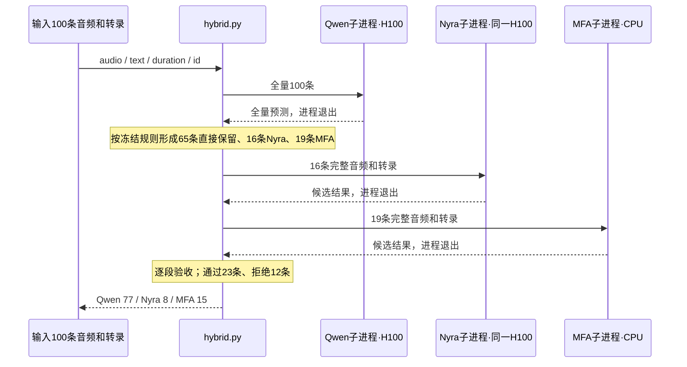

# V2 混合 FA 的具体设计与高 RTF 原因

当前 V2 是**全量 Qwen 基线 + 按句段重对齐 + 整段候选验收**的离线批处理实现。AMI-100 每批都会启动独立的 Qwen、Nyra 和 MFA 进程，顺序执行。它以改善边界质量、保留多数 Qwen 输出为目标，尚未实现模型常驻和速度优化。

单张 H100 三轮端到端 RTF 中位数为 **0.39156**；Qwen 单独处理为 **0.10629**。混合方案耗时约为 Qwen 的 **3.68 倍**。下文用同一批真实运行记录解释开销，不重新跑模型、不更改 V2 策略。

## 1. 一批音频实际怎么运行

入口是 [hybrid.py](../../src/v1/fa/hybrid.py)，规则与验收在 [router.py](../../src/v1/fa/router.py)。执行顺序如下：



具体行为：

1. Qwen 对100条全部运行，并写出 `qwen.jsonl`。后面的回退不会省掉这一步。
2. 父进程读取 Qwen 结果，根据输入文本和预测时间计算路由特征。
3. 按后端汇总请求。先启动一个 Nyra 进程处理16条，再启动 MFA wrapper 与 CLI 处理19条。
4. 每个候选都对**原音频片段和完整转录重新对齐**；当前没有裁剪问题词附近窗口，没有只替换个别词，也没有共享 Qwen 的声学特征。
5. 候选通过验收才替换整段；失败则保留整段 Qwen 结果并标记复核，不再尝试另一个后端。
6. 合并输出 `hybrid.jsonl`，记录请求后端、实际采用后端及复核标记。

每批 Qwen 和 Nyra 各加载一次，不会每条音频都重新加载。MFA 的19条也合并为**一次 CLI 任务**，并非启动19次 CLI。但下一个批次仍会重新启动和加载这些进程。所有阶段串行；MFA 内部使用8个 CPU jobs。

## 2. 冻结路由条件

策略来自 `results/fa/policy.json`，本次基准复制到 `results/fa/ami100_single_h100_v2/policy.json`。SHA256 为：

```text
479e3f5e53807a7754aa41449839566b5600a1f23e81f33ed0b772c40aa84dab
```

按以下先后顺序选择，命中第一条就结束：

| 顺序 | 判断条件 | 请求后端 |
|---|---|---|
| 1 | 转录中填充词 token 比例 ≥ 0.05 | MFA |
| 2 | Qwen 相邻输出词之间的最大空隙 ≥ 0.5秒 | Nyra |
| 3 | 其余 | 直接保留 Qwen |

填充词集合为 `uh, um, erm, er, hmm, mm`，先执行现有词形归一化。比例分母为输入转录的空白分词 token 数；间隙计算为 `max(0, next.start - previous.end)`，不计开头或末尾的静音。

如果同一条既包含足够填充词，又有大空隙，会请求 MFA。**规则优先级与执行调度顺序不同**：规则先判断 MFA，汇总后实际先运行 Nyra，再运行 MFA。

代码也计算 `hard`、短时长比例、超长词、重复词等特征；本次冻结策略只选用了 `fillers` 和 `gap`。因此零时长并非本版必定触发回退的条件，仍有部分零时长会留给复核。MFA 的填充词规则是开发集上选出的经验规则，不代表 MFA 在所有填充词或所有录音条件下都优于 Nyra。

路由只读取输入文本、片段时长和 Qwen 预测，不读取参考词时间、参考质量标签、会议名或噪声条件。

## 3. 回退结果如何验收

候选必须通过以下两层检查。

**完整性与时间结构检查：**

- 输出非空，按现有 Levenshtein DP 与原转录 token 保序匹配，无遗漏、替换或额外 token。
- 起止时间均有限，词时长大于1e-6秒，无负时长。
- 时间不超出片段边界容差20ms，无起点逆序，无超过20ms的词间重叠。

**V2 防退化门：**

- 候选中大于1.5秒的词数量，不能超过 Qwen 中这类词的数量。
- 对 Qwen 中时长处于40ms至1.5秒的词，与候选匹配后，任一起点或终点跳变超过500ms，就拒绝整段候选。

这里的“稳定词”只根据 Qwen 输出时长判断，不代表人工确认正确。该门可以挡住明显的大幅跳变，也可能拒绝正确的大幅修复。

通过全部检查则采用整段候选；否则返回原 Qwen，并标 `needs_review=true`。没有触发回退的 Qwen 结果若自身结构不合格，也标复核。`needs_review=false` 只表示通过这些检查，不是人工准确性保证。

本次每轮：

| 请求来源 | 请求条数 | 候选通过 | 候选拒绝 |
|---|---:|---:|---:|
| Nyra | 16 | 8 | 8 |
| MFA | 19 | 15 | 4 |
| 直接保留 Qwen | 65 | — | — |

最终为 Qwen 77条、Nyra 8条、MFA 15条；需复核29条，其中12条来自候选拒绝，另外17条是直接保留但结构不合格的 Qwen 结果。被拒绝的候选已经完成全部处理，不会退还计算时间。

Nyra 的输入只对独立 `um/uh` token 做 `[UM]/[UH]` 映射，输出恢复原形式。MFA 使用逐段独立 speaker 目录做归一化并关闭说话人自适应，以保持全量评测和按需子集执行的一致性。

## 4. 为什么只回退35条，额外工作量仍很大

按条数和按音频时长计算，会得到不同的比例：

| 实际处理阶段 | 条数 | 输入音频总时长 | 占原数据时长 |
|---|---:|---:|---:|
| Qwen 全量 | 100 | 466.36秒 | 100.00% |
| Nyra 重对齐 | 16 | 229.04秒 | 49.11% |
| MFA 重对齐 | 19 | 112.01秒 | 24.02% |
| 三阶段合计 | 135次片段处理 | 807.41秒 | 173.13% |

被路由的片段偏长。35%的片段触发回退，实际又处理了原数据 **73.13% 的音频时长**。最终77%的输出采用 Qwen，也不意味着只增加23%的工作量。

被拒绝的12条候选合计172.25秒，占回退音频时长约50.51%。这只是按输入时长计算的比例，不能据此断言恰好浪费一半运行时间：进程启动、模型加载和部分批处理成本并不随音频时长线性变化。

## 5. 182.61秒到底花在哪里

以下取第三轮，它也是混合总耗时的中位数所在轮次。三段为同一轮实测值，可以相加：

| 阶段 | 实测墙钟耗时 | 占总耗时 | 计时范围 |
|---|---:|---:|---|
| Qwen 全量100条 | 50.461秒 | 27.63% | 新进程启动、依赖导入、加载、读取音频、对齐、写结果及退出 |
| Nyra 子集16条 | 41.998秒 | 23.00% | 同上；包括完整 WavLM 加载 |
| MFA 子集19条 | 89.881秒 | 49.22% | wrapper、完整新 CLI、语料处理、对齐、TextGrid 导出解析及退出 |
| 父进程其余开销 | 0.269秒 | 0.15% | 路由、验收、读写清单、父进程启动等差值 |
| **总计** | **182.610秒** | **100.00%** | **RTF = 182.610 / 466.36 = 0.39156** |

父进程其余开销是差值，不是纯路由函数的独立计时；可以确定的是，它只占约0.15%。主要耗时在三个子进程的完整执行。

### 神经模型加载与处理的拆分

第三轮 Qwen 和 Nyra 子进程还记录了更细的计时：

| 项目 | Qwen | Nyra | 合计 |
|---|---:|---:|---:|
| 模型加载计时区间 | 30.572秒 | 28.244秒 | 58.816秒 |
| 加载后的处理区间 | 8.448秒 | 3.091秒 | 11.539秒 |
| 子进程其他差值 | 11.440秒 | 10.664秒 | 22.104秒 |

加载区间包含相应 FA 依赖导入及模型构建；处理区间包括音频读取、预处理、首个推理调用、GPU同步和输出，没有预热。其他差值包括计时区间之外的导入、设备初始化、进程退出等，未进一步精确拆分。

仅两套神经模型的加载区间，就占整批混合耗时约32.21%。Nyra 虽然只处理16条，依然需要完整加载其模型。

### MFA 的固定开销与计时边界

第三轮，MFA 子集19条的完整阶段为89.881秒；单独处理100条的同轮 MFA 为93.342秒。当前实现中，减少任务条数没有带来成比例的耗时下降。

MFA wrapper 内记录的 CLI 子进程为88.755秒；CLI 日志自身打印的 `Everything took 55.131 seconds` 只覆盖其内部计时区间，两者相差33.624秒。该差值包含内部计时区间之外的启动、初始化和退出等；没有进一步 profiling，不能把它全归因于声学模型加载，也不能把55.131秒全称为HMM解码时间。

wrapper 的语料整理约0.470秒，TextGrid回读/JSON导出约0.353秒。因此主要成本在完整 CLI 内部及其生命周期，而不是 wrapper 最后的文件解析。

### 三轮波动

| 轮次 | Qwen阶段 | Nyra阶段 | MFA阶段 | 父进程其余 | 总耗时 |
|---|---:|---:|---:|---:|---:|
| 1 | 47.923秒 | 40.284秒 | 86.936秒 | 0.246秒 | 175.389秒 |
| 2 | 62.741秒 | 45.634秒 | 96.751秒 | 0.260秒 | 205.387秒 |
| 3 | 50.461秒 | 41.998秒 | 89.881秒 | 0.269秒 | 182.610秒 |

第二轮两套神经模型的加载区间合计72.355秒，比第三轮多约13.54秒；逐条处理区间合计均约11.54秒。可以观察到加载等阶段存在波动，但现有记录没有进一步区分文件系统等待、CPU调度及其他具体原因。三轮预测逐词一致。

## 6. 当前策略优化的是什么

V2 的参数只在 ES2004a 开发集上搜索，目标为过滤参考上的：

```text
Σ [词MAE秒数（未匹配按1秒） + 0.1 × 是否未匹配或词MAE超过100ms]
```

同时约束开发集最终回退采用比例不超过40%，最多两个有顺序的规则。**目标没有 RTF、模型启动次数或额外处理音频时长的惩罚。** 40%约束也是最终输出采用比例，不是额外GPU/CPU工作量的上限。

因此，这套规则会为了降低边界误差而接受较高的回退成本。本次过滤参考 MAE 从88.27降至75.41ms，Acc@100ms从71.37%升至77.35%，零时长从77降至52；同时端到端耗时升至Qwen的3.68倍。

Nyra 单独运行的 Acc@100ms 为80.13%，高于混合方案；混合方案的平均边界误差更低。这也说明当前 V2 并未同时最优化所有质量指标和速度。

## 7. 可以怎么改进执行架构

以下是待实现的改进方向，未包含在已公布的 RTF 中，本次没有修改实现或重新计时。

| 优先级 | 改进方向 | 对应开销 | 需要保留或验证的行为 |
|---|---|---|---|
| 1 | 在同一张H100上让Qwen/Nyra长期驻留，跨批次复用模型 | 每批重复的神经模型加载与解释器启动 | 固定精度、规则和验收，核对逐词输出与常驻显存 |
| 1 | 为MFA研究可复用的CPU worker及调用方式，减少每批完整CLI启动 | 19条仍需近90秒的完整MFA阶段 | 验证模型/字典/语料状态复用；保持逐段归一化和关闭自适应 |
| 2 | 在单张H100约束下，评估MFA CPU与Nyra GPU阶段重叠执行 | 当前所有阶段严格串行 | 测量CPU争用，不能直接将较短阶段耗时视为必然可节省时间 |
| 2 | 在路由目标中加入候选耗时、请求时长与验收通过概率 | 长片段和低通过率回退 | 重新使用独立验证集评估质量与速度的取舍 |
| 3 | 研究局部时间窗重对齐、共享已解码PCM、减少中间落盘 | 整段重复处理与IO | 新的裁剪/拼接必须验证边界、时间偏移及输出完整性 |

两个容易误判的优化点：

- 目前已将同后端请求合并处理，不存在“把19次MFA调用合并为一次”这项可直接获得的收益。
- 填充词特征可在Qwen前计算，但当前防退化门依赖Qwen结果。若直接跳过这些片段的Qwen，会改变算法和验收依据，必须另作版本验证。

常驻方案的稳态RTF、重叠调度的收益、局部修复的准确度目前都没有实测值。将现有各阶段时间简单扣减后称为优化版RTF，会遗漏首个推理、MFA内部成本及资源争用。

## 8. 证据与代码入口

- [单卡基准与完整准确度/速度表](07_single_h100_v2_benchmark.md)
- [原V2路由及开发过程](03_hybrid_routing.md)
- [批处理编排 hybrid.py](../../src/v1/fa/hybrid.py)
- [特征、选路和验收 router.py](../../src/v1/fa/router.py)
- [Qwen/Nyra模型加载及逐条处理](../../src/v1/fa/run_aligners.py)
- [MFA wrapper、CLI配置与TextGrid回读](../../src/v1/fa/run_mfa.py)
- 测量结果目录：`results/fa/ami100_single_h100_v2/`。
- `design_cost_analysis.json`：本页所用的阶段差值、回退音频时长和通过/拒绝统计。
- `repeat3/hybrid/runtime.json`、`qwen.runtime.json`、`nyra.runtime.json`、`mfa/runtime.json`：代表轮次的原始计时。
- `source/`：实际测量时使用的源码副本；`validation.json`：单卡与结果一致性检查。

质量结果仍相对AMI银标准，独立人工逐词边界金标准尚未建立。
