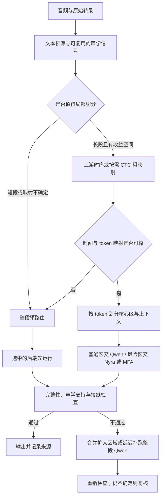

# Qwen 前预路由与问题段粗定位调研

调研日期：2026-11-05。重点审阅 [08：V2 设计与高 RTF 原因](08_hybrid_v2_design_and_rtf.md)，并核对编排、路由、模型接口和已有三轮单卡记录。本次只做资料调研与既有结果的只读汇总，未修改推理代码、未训练检测器、未重新运行模型。

**结论：可以在 Qwen FA 前预测部分高风险输入，并将其直接交给 Nyra/MFA；要进一步只处理问题局部，则需要“时间窗 ↔ 转录词序号”的粗映射。最值得先验证的是低成本整段预路由，其次才是对长片段使用上游时间信息或 CTC 粗对齐。全量再加一个声学检测器，不一定比现有 Qwen 更快。**

这里的 Qwen 指 `Qwen3-ForcedAligner-0.6B`，不是生成转录的 `Qwen3-ASR-1.7B`。本文分别标明已有证据、方案推断和待验证项；所有新路由、阈值及速度收益均未实测。

## 1. 对 08 文档的重点 review

08 对当前执行和耗时的描述与源码、原始记录一致，没有发现影响主结论的数值错误。但把其第 7 节扩展成“Qwen 前发现问题并局部直达其他后端”时，有以下设计边界需要明确。

| 优先级 | Review 发现 | 对新方案的影响 |
|---|---|---|
| 高 | 当前回退单位是整条输入片段；并没有检测出一个局部窗口再裁剪 | “局部直达”需要增加定位、文本切分、上下文和拼接协议，不是把现有 `route()` 提前调用 |
| 高 | 填充词比例不依赖 Qwen，但 `gap`、短词、零时长等依赖 Qwen 输出 | 可先迁移文本风险信号；VAD 停顿不能直接替代原来的 Qwen 词间隙规则 |
| 高 | 防退化门和拒绝后的保底结果都依赖 Qwen | 跳过 Qwen 必须设计独立验收与延迟补跑；不能声称保持 V2 算法等价 |
| 高 | “Qwen 可能错”与“Nyra/MFA 能改善”是两个目标 | 应预测后端相对收益，不能把所有困难音频都交给 MFA |
| 高 | 主要冷进程成本不随跳过几条音频而消失 | 只省 Qwen 的部分处理，可能抵不过全量 VAD/CTC 的新增开销 |
| 中 | 本数据以短片段为主，路由的长片段占了较多时长 | 短片段先做整段选路；长片段才更可能从局部处理获益 |
| 中 | 历史规则只在少量会议上开发，且参考仍是银标准 | 新检测器不能把历史回退标签直接当作真实错误标签，也不能把历史审计集继续称为未见测试集 |

源码证据：[hybrid.py](../../src/v1/fa/hybrid.py) 先生成全量 Qwen，再构造 Nyra/MFA 请求；[router.py](../../src/v1/fa/router.py) 的 `consistent_with_primary()` 比较 Qwen 与候选。尤其该函数在 `primary` 为空时直接返回 `True`：**给它传空 Qwen 不等于完成了新的防退化验证**。这是复用接口时必须避免的错误，不是当前 V2 正常执行路径的问题。

另一个范围限制：现有策略没有证明能发现全部异常。77 个 Qwen 零时长词中只有 6 个是填充词；只提前识别 `um/uh` 覆盖不了其余普通词塌缩。见 [问题分类](06_issue_taxonomy.md)。

## 2. 先拆开三个任务

1. **风险预测**：这条音频或这几个词是否容易对齐失败？允许概率判断，不要求先知道精确词边界。
2. **粗定位**：风险对应原音频的哪个时间窗，以及原转录的哪一段连续 token？时间和文本两者缺一不可。
3. **后端选择**：直接跑 Nyra、MFA、Qwen，还是先解决转录/说话人问题？风险高不意味着更换 FA 一定有效。

例如：文本中的第 12 个 token 是 `um`，可以在 Qwen 前定位到词序号；波形在 3–4 秒有低能量区，可以定位到时间；但二者不一定对应。没有声学文本映射，不能据此把第 12 个词送去对齐 3–4 秒。

相反，如果整条输入本身只有约 1–2 秒，直接把整条音频和完整文本交给指定后端就不需要额外粗定位。已有 AMI-100 的时长统计为：中位数 **1.5875 秒**，81/100 条不超过 5 秒，85/100 条不超过 10 秒，最大 21.74 秒。来源为 [inference_manifest.jsonl](../../results/fa/ami100_single_h100_v2/inference_manifest.jsonl)，按 `duration` 只读汇总。

因此，本文建议把“整段预路由”和“长段局部处理”作为两个独立实验，先验证前者。

## 3. Qwen 前可以获得哪些信号

下表是候选能力与工程判断，不是已经验证的检测准确率或速度排名。

| 手段 | 无需 Qwen FA | 能提供的定位 | 主要价值 | 关键限制与建议 |
|---|---|---|---|---|
| 文本、时长、词典检查 | 是 | 原始 token 序号 | 填充词、重复、截断形式、数字/OOV、文本长度与时长失衡 | 最便宜，优先试；不能单独给出词的时间位置 |
| PCM 统计、能量包络 | 是 | 削波、极低能量等时间区间 | 发现信号异常，辅助切分 | 干净录音也可能发生时间戳塌缩；噪声不能仅由 RMS 可靠判断 |
| VAD | 是 | 语音活动区间及停顿 | 提议句段切点、语音占比、说话区间过碎等特征 | 没有词映射，也不识别目标说话人；建议优先复用上游结果 |
| 已有 ASR 分段、词时序/置信度 | 取决于来源 | 句段或词的粗位置 | 已经产生时，增量成本可能很低 | 本项目当前 ASR 文件没有这些字段；不能把调用 FA 得来的时间戳算作免费上游信号 |
| 小型 CTC 模型 + 对齐/分段 | 是 | token/词的粗区间和局部分数 | 同时建立音频文本对应、发现错配 | 新增声学前向；CTC 弱词、重复及非流利语音可能不稳，只对有收益的子集试 |
| 基于低成本特征的风险/收益分类器 | 是 | 整段；有局部输入时可到窗口 | 组合文本、声学、ASR 信号，预测哪个后端值得调用 | 需要独立标签、校准和域外评测；当前 100 条不足以证明泛化 |
| Nyra 特征或完整对齐作为第一阶段 | 是 | 完整运行后可定位词/音素 | 不再为这些输入先跑 Qwen，可复用 Nyra 特征 | 已支付 WavLM 成本，应该比较直接完成 Nyra 的方案；不是轻量探测器 |

### 3.1 文本预筛：最先验证，但别把经验规则当成正确性判据

现有 `fillers >= 0.05` 可完全在 Qwen 前计算，连词序号也已知。还可读取：重复序列、显式 `th-` 一类截断形式、数字/缩写、后端词典无法处理的 token、总词数/总时长。若上游已有 VAD，可进一步计算词数/有效语音时长。

这些是风险候选特征，不应成为删除词或擅自扩写转录的依据。比如 `1.4` 的读法存在歧义，应记录映射不确定；不能为了通过对齐检查自行认定读成 `one point four`。OOV 也不自动等于 MFA 不支持，因为可能有合法 G2P 发音。

当前填充词规则对 19 条请求选择 MFA，但 V2 只接受了其中 15 条。缺少 Qwen 时，无法直接继承这 15/19 的接受判定。可以把“文本预路由 → MFA → 独立检查 → 必要时补跑 Qwen”设为对照实验，不能直接称为 V2 的无损加速。

### 3.2 VAD：适合找切点，不足以找出 Qwen 的全部错误

Silero 官方提供语音区间接口；其 README 报告单 CPU 线程处理一个 30ms 以上音频块耗时低于 1ms。这是发布方环境的性能描述，不是本项目 H100 流水线的实测。来源：[Silero VAD](https://github.com/snakers4/silero-vad)。

对本任务的推断：VAD 可辅助定位长停顿、弱语音边缘和可切分位置。但必须区分：

- **真实停顿**：声音本来有空隙，Qwen 输出一个较大 gap 可能完全正确。
- **虚假空隙**：仍有语音，Qwen 没有给相应词合理分配时间；仅看 VAD 无法知道它将如何输出。
- **词内部边界误差**：连续语音里若干功能词压缩到同一时间，VAD 往往只会给出一个正常的语音区间。

所以 VAD 的“静音 ≥0.5 秒”不是冻结策略 `Qwen gap >=0.5` 的等价替代。弱填充词可能被 VAD 漏掉，真实多人重叠也不会由普通 VAD 分离。VAD 只作为特征和窗口建议，不作为硬删音频/删转录的依据。

### 3.3 复用 ASR：先确认已有产物，避免形成循环依赖

本地 [asr.jsonl](../../results/fa/asr.jsonl) 当前只有 `text/id/seconds/backend`；[run_aligners.py](../../src/v1/fa/run_aligners.py) 的 ASR 分支只保存最终文本。没有可直接复用的词置信度、分段时间或 CTC posterior。

Qwen 官方时间戳用法需要设置 `forced_aligner`，再请求 `return_time_stamps=True`。因此，**不能把该接口产生的词时间当成 Qwen FA 前的免费定位**。来源：[Qwen3-ASR 官方用法](https://github.com/QwenLM/Qwen3-ASR#python-package-usage)。

未来若上游本来就按 VAD 块识别，可保留每块音频起止与块内文本，先获得粗粒度对应；若另有原生 CTC posterior 或独立 ASR 词时间，则可复用。所有这些都需要记录来源。为了预筛新跑一遍 ASR，必须把完整 ASR 成本计入，不能只计后续路由时间。

### 3.4 CTC 粗对齐：最直接补齐“时间—文本”映射的通用路线

CTC segmentation 使用 CTC 网络输出建立文本到音频的映射，并可生成分段置信分数；它本身不包含声学模型。作者实现还说明，缩短打分窗口会同时提高对文本错误及 ASR 模型错误的敏感度。来源：[论文](https://arxiv.org/abs/2007.09127)、[作者实现](https://github.com/lumaku/ctc-segmentation)。

建议研究的流程是：对选中的长片段生成一次 CTC emission，同时做参考文本约束对齐和轻量 greedy 解码；由对齐路径给出粗词序位置，以局部低支持分数、greedy 文本与原文的不一致、重复段歧义形成风险区间。将分数作为特征，在开发集校准；不能把 posterior、熵或路径分数直接解释成“Qwen 将出错的概率”。以下是本文建议的信号组合，尚未验证：

- 风险词在约束路径上的声学支持弱，且周围有稳定匹配的锚点。
- 同一位置的 greedy 文本与原转录不一致；先分开词形规范化差异与真实内容差异。
- 路径在重复序列间存在定位歧义，或某些词只能被压进很少的帧。
- 文本需要解释的内容与 VAD 语音活动明显不一致。

**CTC 的主要用途是找包含目标词的宽窗口，不是取代最终精细边界。** PyTorch 教程明确讨论了 blank 在词内和词间的解释歧义，因此高分路径不保证 100ms 级词边界正确；低分也可能只是 CTC 模型不熟悉 AMI 会话语音。来源：[CTC 对齐教程](https://docs.pytorch.org/audio/stable/tutorials/ctc_forced_alignment_api_tutorial.html)。

可做最小对照的候选：

| 候选 | 用途 | 选型约束 |
|---|---|---|
| `facebook/wav2vec2-base-960h` + CTC segmentation | 英语粗定位基线，检查是否比额外 Qwen 调用划算 | 官方模型面向 16kHz LibriSpeech；与会话、填充词和重叠有域差异，不预先认定足够鲁棒。[模型卡](https://huggingface.co/facebook/wav2vec2-base-960h) |
| 已有 NeMo CTC / Hybrid-CTC 模型 + NFA | 上游已经使用 NeMo 时复用 log-probs 和分段 | 官方 NFA 支持 token/word/segment 时间；纯 Transducer 不可直接作为其 CTC 输入。不为预筛默认新引入整套大模型。[官方文档](https://docs.nvidia.com/nemo-framework/user-guide/latest/nemotoolkit/tools/nemo_forced_aligner.html) |

实现时还需注意版本：PyTorch 官方教程标明其旧 `forced_align` 等 API 在 2.8 弃用、2.9 移除。可参考算法，但不能以该旧教程默认保证当前新环境可运行。本项目原环境为 torch 2.6.0；若将来实验，单独固定兼容环境或选择仍维护的实现。本次未安装/升级依赖。

### 3.5 不应优先采用的“捷径”

- **读 Qwen 自身置信度来省 Qwen 前向**：本地 0.0.6 在 `model.thinker(**inputs)` 后才取时间戳 logits。logit 熵等可辅助事后质量检查，却不能省掉已经发生的前向。要做中间层早退/探针是另一项需要训练验证的研究。官方源码可核对：[Qwen FA 实现](https://github.com/QwenLM/Qwen3-ASR/blob/main/qwen_asr/inference/qwen3_forced_aligner.py)。
- **先全量 MFA validate，再选路由**：官方说明包含语料/字典初始化，启用声学检查时还会提特征并试对齐；不是免费的声学预检。纯文本/OOV 检查有价值，但优先复用字典检查，不额外启动完整声学验证流程。[MFA 数据验证](https://montreal-forced-aligner.readthedocs.io/en/latest/user_guide/data_validation.html)。
- **按词数均分语音时间**：可以给粗糙先验，无法保证停顿、拖音、重复和快语速时包含正确词；不得作为可信裁剪或最终时间戳。
- **仅凭音频质量分数选 MFA**：低 SNR、重叠或混音表示输入困难，并不证明 MFA 相对 Nyra/Qwen 更好；内容范围错误应先解决上游文本/说话人问题。

## 4. Nyra 可以更早使用，但要比较两种不同架构

本地 Nyra 0.2.2 已有 `features_torch(audio)` 和 `align_features(feats, text)`；`align()` 实际就是串联这两步。模型使用 WavLM 特征和 GMM-HMM 解码，并非可以直接替代上述 CTC posterior 的 CTC 模型。官方也公开了缓存特征再对齐接口：[Nyra 官方仓库](https://github.com/nyrahealth/nyra-forced-aligner)。

由此得到两个方案：

1. **轻量预筛后直达 Nyra**：只给预先选中的整段或窗口提取特征并对齐，省去这些输入的首轮 Qwen。
2. **Nyra 先对齐，再决定是否补跑其他后端**：若为了检测已经提取完整 WavLM 特征，应比较顺势完成 Nyra 解码，而非再跑 Qwen 后又回到 Nyra。该方案改变“Qwen 主导”的选型约束，适合作为显式对照，不在本次直接替换架构。

本地接口的限制也已核对：`AlignmentResult` 有 words、phones、silences、skipped，但没有现成的校准置信度。若要用 HMM 分数判断结果可靠性，需要另行暴露、归一化和校准，不能假定当前 JSON 已具备。

特征复用也有边界：[features.py](../../models/fa-runtime/nyra/nyra_align/features.py) 有上下文特征、插值、逐段 CMVN 等处理。**整段特征切片与把音频裁成小段重新提特征，不保证等价**；局部缓存要固定帧到原时间的映射、归一化范围和上下文协议。Nyra 特征也不能直接送给 Qwen 或 MFA，最多共享解码后的 PCM 等通用输入。

当前固定 AMI-100 上，Nyra 单独端到端中位数 44.231 秒，Qwen 为 49.570 秒；Nyra 的过滤 Acc@100ms 更高，但过滤 MAE 122.47ms 高于 Qwen 的 88.27ms 和 V2 的 75.41ms。外部会议审计则 Nyra 过滤 MAE 优于两者。因而有必要比较 Nyra 优先，但不能以某一个指标宣称它在所有输入上更好。数据见 [单卡基准](07_single_h100_v2_benchmark.md)、[外部审计](05_external_audit.md)。

下一轮可按以下方式组织后端对照，不能把它直接视为已验证的生产规则：

| 预先可见的情况 | 候选处理 | 为什么需要这个对照 |
|---|---|---|
| 短片段、含填充词，文本可解释 | 整段 MFA 与整段 Nyra 分别对照 | 现有规则支持尝试 MFA，但没有证明所有填充词都应优先 MFA；两者相对收益需重新验证 |
| 口语事件、截断形式，或局部噪声风险且文本可信 | 优先研究 Nyra 候选 | 其事件建模提供机制上的理由；最终仍以本地分组收益和退化统计选定 |
| 只有长停顿，文本与语音对应正常 | 保留正常后端；有可靠文本分区时再切段 | 长停顿本身不是对齐错误，无需因此强制转 MFA/Nyra |
| CTC/ASR 与原文严重错配，或目标说话人不明确 | 转录/说话人复核；不直接承诺 FA 修复 | 可能是内容范围问题，多跑一个 FA 也无法确定目标内容 |
| 特征不足以判断相对收益 | 默认 Qwen 或冻结的单模型基线 | 保留“不确定”路径，避免为了提高预路由比例而硬选后端 |

## 5. 真正的“局部直达”需要怎样的协议

以下是待验证设计，不是现有 V2 功能。



### 5.1 窗口定位必须同时包含时间和文本

每个窗口至少需要：原片段 ID、原始 token 范围 `[i,j)`、核心时间范围、带上下文的实际裁剪范围、上下文 token 范围、原时间偏移、映射来源/置信信号、请求后端及原因。原 token 序号是主键，不能用词字符串作主键，否则重复的 `we we` 会混淆。

建议先寻找问题簇左右的可靠锚点，窗口覆盖问题词及邻近短语。对填充词可能被粗模型跳过的情形，用两侧锚点夹出的较宽范围；找不到两侧锚点时扩到整句或整条输入。不能把“定位不到”转换成一个假定的窄窗。

作为开发阶段的起点，可比较每侧 0.3–0.5 秒上下文与按完整相邻词扩窗等方案；这些数值只是实验候选，不是安全阈值。核心窗口之外若确实包含其他词的声音，其文本也应作为上下文送入，最后只采纳归属核心区的 token。

### 5.2 正常区域也必须有完整的输出路径

若风险区跳过 Qwen，正常区仍需被某个后端处理。不能只输出被修复的小窗口，也不能整段照跑 Qwen 后声称已跳过风险区的首轮成本。

可先按较稳定的句段/停顿与 token 映射形成覆盖完整转录的分区：每个 token 恰好属于一个核心区；相邻输入允许上下文重叠，最终输出按核心 token 所有权拼接。这样 Qwen 只负责普通区，Nyra/MFA 负责风险区。

分区后的 Qwen、Nyra、MFA 都可能与整段输出不同；上下文变化、CMVN 变化、额外调用数和重叠音频都要计入质量与速度。对已经很短的输入，这些成本通常缺乏可摊薄的空间，实际是否划算仍需测量。

### 5.3 拼接与拒绝路径

- 每个局部时间加的是实际裁剪起点；若输入已是会议片段，不再重复加会议 offset，发布到会议时间轴时才统一转换。
- 保留原 token 覆盖与保序检查、正时长/有限/越界/逆序/重叠检查，并额外检查接缝邻近词。
- 比较上下文共享词和左右锚点是否一致；不能简单排序、截断或拉伸时间来掩盖冲突。
- 接缝或映射不可靠时，把相邻区合并后重试，或回到整条原输入。对实际多人重叠，应转交说话人/转录复核，不能强制挤成单说话人顺序。
- 同后端窗口继续批量提交，尤其不能为每个 MFA 小窗口分别启动 CLI。

## 6. 跳过 Qwen 后如何验收

新门控至少分两层：

**硬结构层**保留 V2 的完整性和时间结构要求。对无法规范化成一一对应的数字、缩写、事件标签，保留显式原 token 映射；映射不确定就复核，不通过删词来“通过”验收。

**声学与映射层**结合可获得的独立证据：上游/CTC 锚点支持、候选是否把词放在明显不含目标语音的区域、是否发生异常长词及接缝漂移。VAD 和粗模型都可能错，应该允许“不确定”，不把一致性包装成人工正确性。

采用 **延迟补跑 Qwen**：预路由后先获得 Nyra/MFA 候选，只有独立门不通过或信号冲突时，才对必要范围补跑 Qwen。若需套用原 V2 的整段比较语义，则补跑整条原输入；裁剪区的 Qwen 输出不能冒充原整段 Qwen 基线。补跑后仍可能全部不可信，保留复核标记。

这无法保证恢复 V2 所有决策：旧门会拒绝的候选可能通过新门，反之亦然。需要单独统计“新门接受、原 V2 拒绝”的样本，盲审其真实退化率。**拒绝率低不是好门控的充分证据。**

## 7. 能快多少：必须先算新增检测的预算

### 7.1 现有记录能支持什么

三轮现有 `hybrid/qwen.jsonl` 都有逐条 `seconds`。以同轮 `hybrid.jsonl` 的 `requested_backend` 分组求和，得到下表；它只描述已经发生的处理时间，不是模拟新路由后的实测。

| 已有 Qwen 处理记录 | 第 1 轮 | 第 2 轮 | 第 3 轮 |
|---|---:|---:|---:|
| 后续请求 MFA 的 19 条，逐条计时之和 | 0.614s | 0.593s | 0.603s |
| 后续请求 Nyra 的 16 条，逐条计时之和 | 5.481s | 5.579s | 5.759s |
| 其中第一条输入自身耗时 | 4.950s | 5.059s | 5.220s |
| Nyra 组排除第一条后的其余 15 条 | 0.531s | 0.521s | 0.540s |
| 直接保留 Qwen 的 65 条 | 2.019s | 2.007s | 2.047s |

证据：`results/fa/ami100_single_h100_v2/repeat{1,2,3}/hybrid/{qwen,hybrid}.jsonl`。例如 [第 3 轮 Qwen 记录](../../results/fa/ami100_single_h100_v2/repeat3/hybrid/qwen.jsonl) 与 [最终记录](../../results/fa/ami100_single_h100_v2/repeat3/hybrid/hybrid.jsonl)。汇总方法为按 ID 关联请求后端，再求各组 `seconds`；未重新推理，也未拟合速度模型。

第一条都是 `IS1009a_A_012_headset`，且没有预热。其较高耗时不能全部当作可通过路由永久消除的成本：保留其他 Qwen 请求后，首调用相关开销可能转移，现有记录无法分解其具体来源。排除第一条的数值也只是诊断，不是严谨热态基准。

这意味着：

- 若把原 19 条 MFA 请求提前，并且无需为其中任何一条补跑 Qwen，历史记录对应的 Qwen 逐条工作量约为 **0.6 秒量级**；Qwen 进程与加载仍在。这不是新执行的实测省时，发生补跑还会进一步减少收益。它是最便宜的算法实验，但不能期待解决 182.61 秒总耗时。
- 不应按 35 条回退或 73.13% 的回退音频时长，线性扣除 50.461 秒的 Qwen 阶段。
- 第 3 轮 Qwen 加载后整个处理区间也只有 8.448 秒，其中含首调用。新声学预筛必须与这类增量成本比较，不能只与含加载的 Qwen RTF 0.10629 比。
- Nyra 子集加载后处理 3.091 秒，而 MFA 完整阶段 89.881 秒。只把窗口切短，既不会自动省掉 Nyra 的模型加载，也不会自动省掉 MFA 的 CLI 生命周期。

### 7.2 一个用于决策的成本模型

相对“这些输入先 Qwen 再回退”的基线，顺序执行时预路由只有在下式成立时才有速度收益：

```text
预筛成本 + 粗定位成本 + 裁剪拼接成本
  + 延迟补跑成本 + 新增/扩大的回退成本 + 生命周期成本变化
< 被省掉的 Qwen 工作 + 被省掉的整段回退工作
```

“生命周期成本变化”按真实执行计算，可为负，也可为正；至少一条输入仍需某后端时，不可按时长比例减去它的整次模型加载。若 CPU/GPU 重叠，最终还要以调度后的墙钟关键路径评估，不能只相加 CPU 秒与 GPU 秒。

一个仅用于说明预算的算例：若保留原回退集合、用 30% 音频时长作预路由，粗略套用 Qwen 第 3 轮处理 RTF `8.448/466.36≈0.0181`，可避免的部分约 2.53 秒。仅新增预筛若耗 5 秒，就无法靠这部分 Qwen 省时回本。这里的线性近似包含首调用，**不是收益预测或性能上限**；它只说明为什么必须测预筛成本。如果还能减少 MFA/Nyra 整段重跑，则需另加实测收益。

应同时约束窗口数、带上下文的总音频时长和后端启动数。检测更多风险不一定更快，粗定位也可能因上下文膨胀让实际处理时长超过原段。

## 8. 推荐的实验顺序

以下是后续计划，不在本次执行。

| 顺序 | 实验 | 要回答的问题 |
|---|---|---|
| 0 | 固定现有 Qwen、Nyra、V2 对照；区分冷进程与常驻批处理 | 新方法要超过哪个质量/成本基线？模型常驻与预路由收益分别是多少？ |
| 1 | 只用文本/时长做整段预路由；补充 Nyra 优先对照 | 不新增全量声学模型，直接选后端能否降低成本且控制尾部退化？ |
| 2 | 复用上游 VAD/ASR 分段；缺失时单独测 VAD 成本 | 这些信号能否提高相对后端收益预测，误报是否过多？ |
| 3 | 只对有收益空间的长段做 CTC 粗定位 | 问题词是否被窗口包住，文本是否正确对应，新增成本是否回本？ |
| 4 | 在可靠映射上做分区处理、独立验收与延迟 Qwen | 能否实际省掉重复音频处理，同时不增加遗漏和接缝错误？ |
| 5 | 数据足够后训练轻量收益路由器 | 比简单规则是否有稳定增益，跨会议是否仍校准？ |

首轮不建议给所有 100 条加完整 CTC，也不建议直接把 `gap` 改成 VAD 停顿就发布。对于现有批处理 RTF，模型常驻、MFA 调用方式与调度仍是并行的性能研究方向；这些与预路由可以组合，但须分别测量贡献。

后端选择应比较 `E[该后端的边界损失 | 预先可见特征] + λ × E[新增耗时]`，并加上超大偏移/遗漏风险约束。在小样本阶段用可解释分桶和冻结规则，避免复杂分类器过拟合。标签需要体现“替代后端比 Qwen 改善多少”，而非仅模仿历史 `requested_backend`。

## 9. 验证协议与继续投入的条件

### 9.1 标签与数据划分

开发时可以离线运行全量模型、用参考计算 Qwen 失败和后端收益；上线决策只能读预先可得特征。训练标签使用参考与模型结果是允许的，但不能把参考边界、参考质量标签、条件名称或未来 Qwen 输出作为运行时输入。

失败标签至少分开：结构无效/词缺失；任一词边界误差超过 100ms；严重偏移；内容或说话人范围不符。后端收益同时看完整、过滤参考和尾部，防止平均值掩盖退化。历史请求 35 条并不是“全部问题音频”的真值集合。

同会议、同事件及其 headset/mixed/noise 变体不可跨训练验证集合。现有 ES2014a/TS3003a 已经公开审计结果；如果用其结果调新方案，就应重新安排未参与设计的会议作为最终测试集。人工盲标应包含随机正常样本、预筛漏报、直接采用后端以及接缝样本，沿用 [参考协议](01_reference_and_protocol.md)；不能仅听审检测器报出的异常。

### 9.2 必须一起报告的指标

| 层次 | 核心指标 |
|---|---|
| 风险预测 | 各类问题的 precision/recall、漏报严重偏移、概率校准；同时给按条数和按音频时长的工作量 |
| 粗定位 | 问题词真实区间被窗口完整覆盖的比例、token 区间映射正确率、窗口/原音频时长比、上下文膨胀比例；结构无效词用参考或人工区间评估覆盖 |
| 后端选择 | 直接采用后真实改善/退化比例、严重退化率、延迟 Qwen 比例、额外后端启动次数 |
| 最终质量 | 与 07 一致的 Acc@50/100/200ms、完整/过滤 MAE、P95/P99、零时长、缺失/多余 token、复核率；不能只看零时长消失 |
| 局部拼接 | 接缝邻近词错误、上下文不一致、冲突后扩大/整段重跑的频率 |
| 性能 | 同一单卡配置下端到端墙钟 RTF，冷进程与常驻分别报告；检测/定位/各后端/拼接/补跑耗时，GPU/CPU资源及实际输入时长 |

基线至少包括 Qwen-only、Nyra-only、现有 V2、仅常驻/调度优化的 V2、文本预路由，以及增加粗定位后的方案。这样才能判断收益来自模型加载优化、后端改变，还是定位器本身。

离线可计算“若事先知道最佳后端”的 oracle 作为质量/收益空间参考；必须标注不可部署，也不能从全量三模型缓存重放中推导真实端到端 RTF。局部裁剪的输出会变化，整段缓存不能代替裁剪实验。

继续投入的条件应在看新测试结果前冻结：质量允许的变化、严重退化上限、最低端到端收益和补跑预算。若预筛耗时超过实际省下的工作，或为了召回困难词导致大多数音频都转交其他后端，应停止增加检测复杂度，转而比较更简单的常驻单模型/整段选路方案。

## 10. 本次建议落点

**先把“问题输入直接交给合适后端”做成整段预路由实验；把“只处理局部问题段”保留给长片段和可靠粗映射。** 文本规则可立即作为后续实验起点，上游已有时序优先复用；没有时序时，CTC 是可行的研究候选，但要先证明其成本低于所省工作。

当前无法从公开资料或这批旧结果得出新方案的检测准确率、局部定位召回率或优化后 RTF。可以确定的是，跳过部分 Qwen 在技术上可行，当前 V2 的验收与保底语义需要随之改变，且主要冷进程耗时不会因预路由自动消失。

本次保留原始实验和实现，仅新增本调研与文档导航；外部依据均链接到项目官方文档、代码或作者论文，外部性能数字不作为本项目基准。
